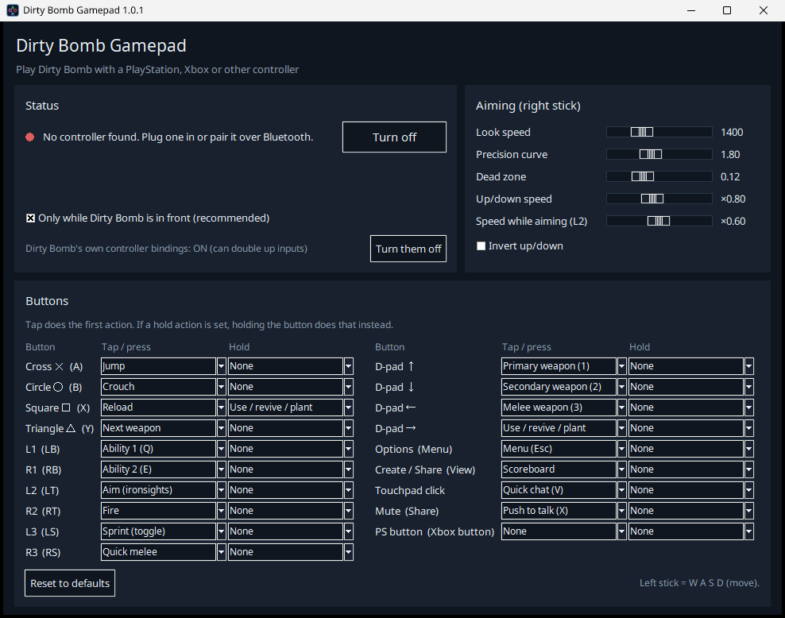

# Dirty Bomb Gamepad

Play **Dirty Bomb** with a controller. It works with PlayStation 4 and 5 (DualShock 4, DualSense), Xbox, Switch Pro, 8BitDo and the other pads SDL2 recognises, and the buttons are labelled the PlayStation way.



Dirty Bomb has no real controller support. This small app reads your controller and turns it into the keyboard and mouse input the game already understands:

- the left stick presses **W A S D**
- the right stick moves the **mouse**, with a speed curve and a dead zone you can tune
- the buttons press Dirty Bomb's default keys

It only sends input while Dirty Bomb is the window in front, and lets go of every key the moment you tab out.

## Download

Get **DirtyBombGamepad.exe** from [Releases](../../releases). It's a single file with nothing to install. Run it, plug in or pair your controller, then start Dirty Bomb.

Windows SmartScreen or your antivirus may warn you, because the .exe isn't code-signed. That's normal for small open-source apps built with PyInstaller. You can read every line in this repository, or build it yourself (below).

## Default layout (PlayStation)

| Button | Does | Dirty Bomb key |
|---|---|---|
| R2 | Fire | Left mouse |
| L2 | Aim (ironsights), and slows the look while held | Right mouse |
| Cross ✕ | Tap: jump. Hold a moment: long jump | Space / Left Alt* |
| Circle ○ | Crouch | Left Ctrl |
| Square □ | Tap: reload. Hold: use / revive / plant / defuse | R / F |
| Triangle △ | Next weapon | Mouse wheel |
| L1 / R1 | Abilities | Q / E |
| L3 | Sprint (toggle) | Left Shift |
| R3 | Quick melee | Middle mouse |
| D-pad ↑ ↓ ← | Primary / secondary / melee weapon | 1 / 2 / 3 |
| D-pad → | Use / revive / plant | F |
| Options | Menu | Esc |
| Create / Share | Scoreboard | Tab |
| Touchpad click | Quick chat | V |
| Mute | Push to talk | X |

\* Long jump presses **Left Alt**. Dirty Bomb doesn't bind Alt by default. Bind it yourself by adding this line under `[ShooterGame.SGPlayerInputPawn]` in `ShooterInput.ini`, with the game closed:

```
Bindings=(Name="LeftAlt",Command="Duck | Jump")
```

Any button can be changed in the app. Each button has a **tap** action and an optional **hold** action, like Square above.

Settings are saved next to the .exe in `dbpad_settings.json`.

## Tips

- **Steam Input:** if you start Dirty Bomb from Steam with Steam Input on for your controller, Steam may translate the pad too. Turn Steam Input off for Dirty Bomb (Properties, Controller), or leave this app off.
- **A button does two things?** For example, holding R2 makes the game aim. That means Dirty Bomb can see your controller itself: an Xbox pad, or a PlayStation pad through Steam Input or DS4Windows. Its leftover Unreal Engine 3 Xbox bindings then fire alongside this app. Close Dirty Bomb and click **Turn them off** in the app's Status box. That comments out the game's `XboxTypeS_` bindings in `Documents\My Games\UnrealEngine3\ShooterGame\Config\ShooterInput.ini`, saving a backup as `ShooterInput.ini.dbpad-backup`. **Turn them back on** undoes it exactly. Keyboard and mouse bindings are never touched.
- **Rebound keys in game?** Pick the matching action in the app, or edit `dbpad/actions.py` and build.
- **Online play:** Dirty Bomb uses EasyAntiCheat. This app only sends normal keyboard and mouse input through Windows (`SendInput`), the same way macro keyboards and accessibility tools do. It doesn't touch the game's memory or files. Use it at your own risk all the same.

## Build it yourself

You need Python 3.10 or newer on Windows.

```bat
build.bat
```

This creates a private virtual environment, installs [PySDL2](https://github.com/py-sdl/py-sdl2), `pysdl2-dll` (SDL2 itself) and [PyInstaller](https://pyinstaller.org), runs the tests, and writes `dist\DirtyBombGamepad.exe`.

To run from source: `python main.py`. Tests: `python -m unittest discover -s tests -t .`

## How it works

| File | Job |
|---|---|
| `dbpad/pad.py` | Reads the controller with SDL2's game controller API, so every supported pad comes out in one layout. It keeps reading while the game window is in front. |
| `dbpad/mapper.py` | Turns buttons and sticks into key presses, mouse buttons, wheel clicks and mouse movement. It handles tap and hold, toggles, and several buttons sharing one key. It's pure logic, and it's tested. |
| `dbpad/sendinput.py` | Sends the input with Windows `SendInput`: keys as scan codes, which DirectInput and raw-input games read, and relative mouse motion. It also checks whether Dirty Bomb is the window in front. |
| `dbpad/app.py` | The window, made with tkinter. |

## Credits

- [SDL2](https://libsdl.org) (zlib licence), with its controller database
- [PySDL2](https://github.com/py-sdl/py-sdl2) (public domain / zlib)
- Built with [PyInstaller](https://pyinstaller.org)

Not affiliated with Splash Damage or Nexon. Dirty Bomb is a trademark of its owners.

## Licence

MIT
